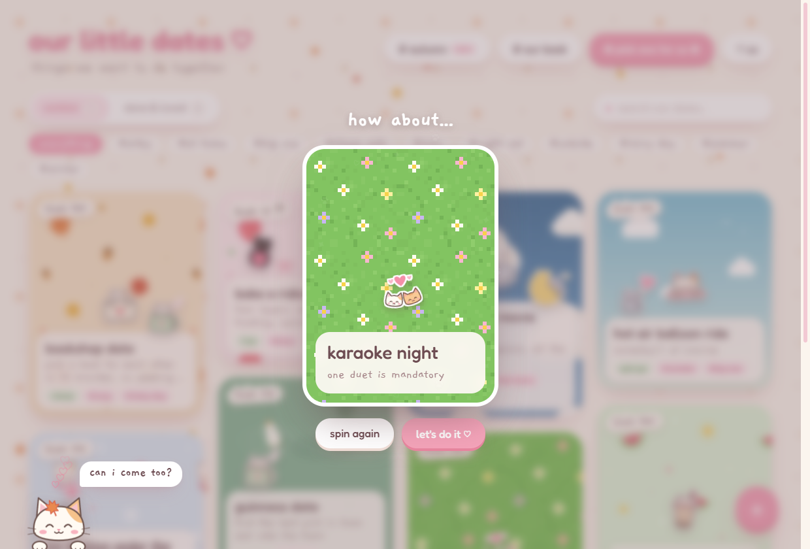
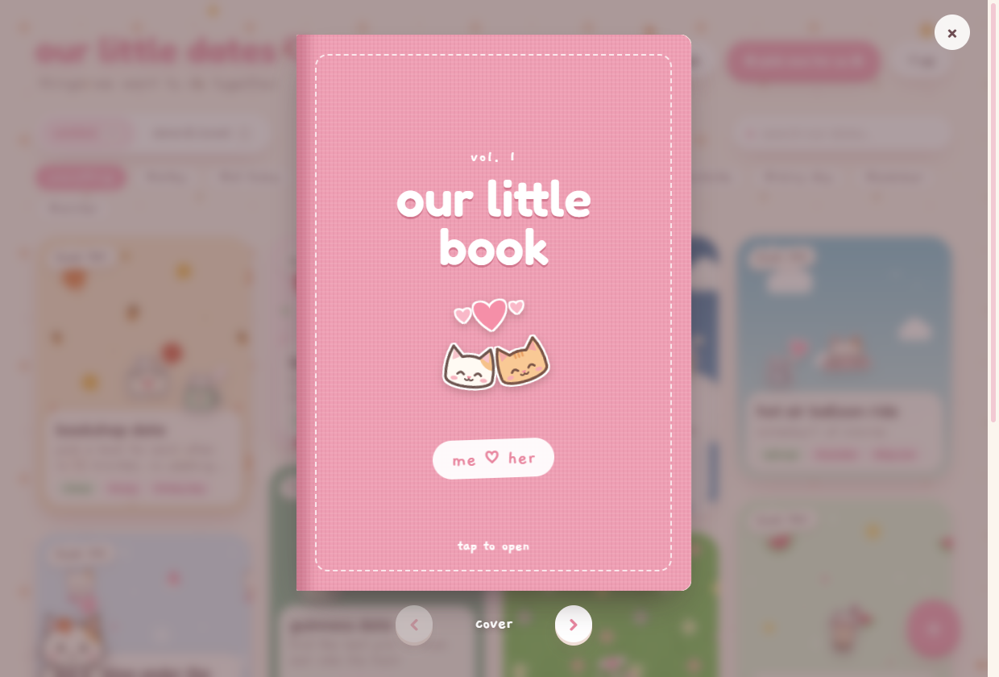
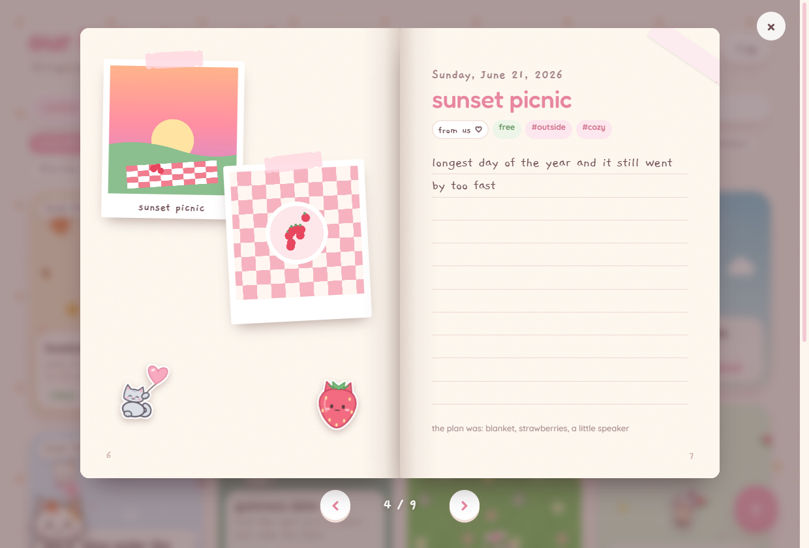
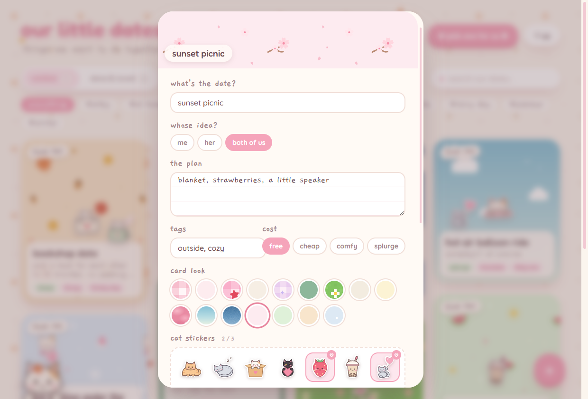

<div align="center">


# our little dates ♡

**a soft little board of date ideas for two**

Collect the dates you want to go on, let a shuffle pick one for you, and keep the ones you've
done in a flip-through scrapbook, all drawn in pastel with a lot of cats.


</div>

---

## ✿ what it does

| | |
|---|---|
| **wishlist board** | Pinterest-style cards for every date idea, with who suggested it, the plan, tags and a rough cost (free / cheap / comfy / splurge). |
| **done & loved** | Tick "we did it!", pick the day and write a little memory. The card gets a "done ♡" stamp and moves to its own tab. |
| **photos** | Drop up to 6 photos on a date. The first one becomes a taped-on polaroid on the card. |
| **pick one for us** | Can't decide? A shuffle runs through your wishlist, slows down like a prize wheel and lands on tonight's date. |
| **our book** | A 3D page-flip scrapbook that turns every finished date into a spread: polaroids on the left, the date and your memory on the right. |
| **cat stickers** | 14 hand-drawn cat stickers (bread loaf, boba cat, moon nap…). Slap up to 3 on any card. |
| **card looks** | 15 themes, from gingham and sakura to pixel meadow, galaxy and a snowy cat. |
| **seasons** | Petals, sparkles, leaves or snow drift down the window. Follows the calendar or can be set by hand. |
| **mochi** | A little mascot cat in the corner who reacts to what you do. You can pet her (she keeps count). |
| **search & tags** | Search across titles, plans, memories and tags, or filter with one tap on a tag chip. |

## ♡ screenshots

<table>
  <tr>
    <td width="50%"><br><sub><b>done & loved</b>: finished dates with their photos and dates</sub></td>
    <td width="50%"><br><sub><b>pick one for us</b>: the shuffle has landed</sub></td>
  </tr>
  <tr>
    <td width="50%"><br><sub><b>our book</b>: the cover</sub></td>
    <td width="50%"><br><sub><b>our book</b>: a spread for one memory</sub></td>
  </tr>
  <tr>
    <td width="50%"><br><sub><b>editor</b>: plan, tags, cost, card look and stickers</sub></td>
    <td width="50%"><br><sub><b>wishlist</b>: everything we still want to do</sub></td>
  </tr>
</table>

<sub>Screenshots use made-up demo dates.</sub>

## ✦ getting started

You need [Node.js](https://nodejs.org/) 18 or newer.

```bash
git clone https://github.com/samxertem/our-little-dates.git
cd our-little-dates
npm install
npm start
```

On first launch the board comes with a few example dates so it isn't empty. Edit or delete them whenever you like.

**shortcuts:** `Ctrl+N` new date · `Esc` close a window · `←` / `→` turn pages in the book

## ❦ where your dates live

Everything stays on your computer. There is no account, no server and no tracking.

| what | where (Windows) |
|---|---|
| dates, names, settings | `%APPDATA%\our-little-dates\dates.json` |
| photos | `%APPDATA%\our-little-dates\photos\` |

Click **♡ us** in the app to see the exact path. To back up, copy that folder.

A few safety nets are built in:

- **Safe saves.** The list is written to a temp file first and then swapped in, so a crash mid-save can't corrupt it.
- **Broken file?** If `dates.json` can't be read, a copy is kept as `dates.broken-<time>.json` instead of being overwritten.
- **Photos are never deleted.** Photos no date uses anymore are moved to `photos\unused\`.

## ⚙ how it's built

A plain [Electron](https://www.electronjs.org/) app: no framework and no bundler. All the art (stickers, themes, Mochi, seasons) is SVG drawn in code, so there are no image assets to manage.

```
main.js       Electron main process: window, saving/loading, photo storage, photo:// protocol
preload.js    the only bridge between the page and the disk (load, save, add photo, tidy photos)
index.html    page layout + all the overlays (editor, picker, book, names)
app.js        the board: rendering cards, editor, photos, search, tags, the shuffle picker
book.js       "our little book": builds the pages and does the 3D page flips
themes.js     the 15 card looks + the four seasons and their drifting particles
stickers.js   the 14 cat stickers, drawn as SVG
mochi.js      Mochi the mascot cat and her moods
styles.css    everything pastel
```

Some details:

- **Locked down by default.** `contextIsolation` is on and `nodeIntegration` is off. The page only reaches the disk through the five functions in `preload.js`, and a strict Content-Security-Policy blocks remote content.
- **Photos as files, not base64.** Imported photos are shrunk to at most 1600px JPEGs in the page, checked again in the main process and saved as files. A custom `photo://` protocol serves only file names that match a strict pattern, so the page can show a photo without seeing the rest of the disk.
- **No `innerHTML`.** Every element is built with a tiny `h()` helper using `textContent`, so anything you type shows up as plain text.
- **Stable randomness.** Sticker positions, polaroid tilt and card heights come from a hash of the date's id, so each card looks "randomly" placed but stays the same every time.

### make it yours

Two small functions control the app's personality:

- `pickDate()` in [`app.js`](app.js) decides where the shuffle lands. Right now it's a fair coin flip over the wishlist.
- `buildBook()` in [`book.js`](book.js) decides which dates get a page and in what order. Right now it's every finished date, oldest first.

### screenshots / previews

The app has a built-in headless preview mode that renders off-screen into a **throwaway** data folder, so it never touches your real list:

```bash
# bash
DATES_SNAPSHOT=out.png npx electron .
# run some code first, e.g. open the book
DATES_SNAPSHOT=book.png DATES_SNAPSHOT_JS="openBook()" npx electron .
```

## ♡

Made with love for my favourite person.
