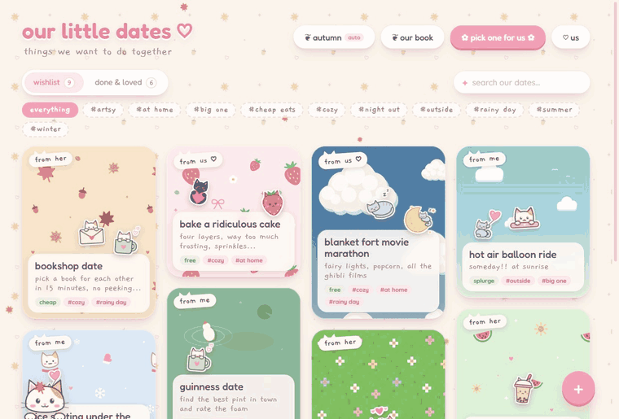
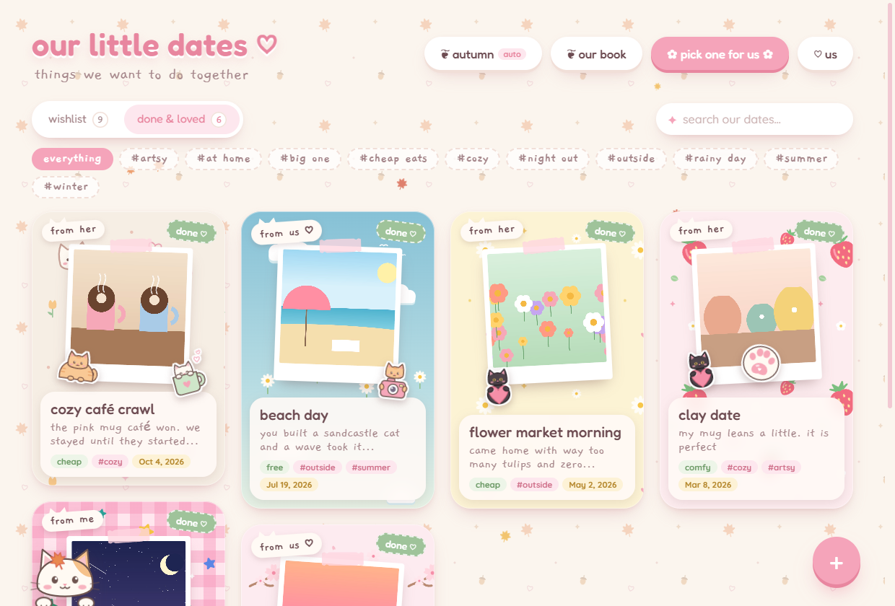

<div align="center">


# our little dates ♡

*a soft little board of date ideas for two*


</div>

<br>

we kept saying "we should do that sometime" and then forgetting what *that* was.
so now there's a little board for it. every idea gets a card, every date we actually
go on gets a page in our book, and there is a cat in the corner watching over all of it.

<br>

## ✿ what's inside

🐾 &nbsp;a **wishlist** of date ideas, each on its own little card. who thought of it, the plan, a few tags and how much it'll cost (free, cheap, comfy or splurge)

🐾 &nbsp;**done & loved**: once we go, the card gets a stamp, the day we went and a tiny memory

🐾 &nbsp;**photos**, up to six per date. the first one gets taped onto the card like a polaroid

🐾 &nbsp;**pick one for us** for nights we can't decide. it shuffles through the wishlist, slows down and lands on one

🐾 &nbsp;**our little book**, a scrapbook you flip page by page with a photo spread for every date we've done

🐾 &nbsp;14 **cat stickers** to slap on the cards (bread loaf, boba cat and moon nap are the best ones)

🐾 &nbsp;15 **card looks**: gingham, sakura, pixel meadow, galaxy, a snowy cat…

🐾 &nbsp;**seasons**, so petals, sparkles, leaves or snow drift down the window depending on the month

🐾 &nbsp;and **mochi**, who lives in the corner. you can pet her. she keeps count

<br>

## ♡ a little look

<p align="center">
  
</p>
<p align="center"><sub>✦ can't decide? let the shuffle pick for us ✦</sub></p>

<br>

<p align="center">
  
</p>
<p align="center"><sub>✦ flipping through our little book ✦</sub></p>

<br>

<p align="center">
  
  
</p>
<p align="center"><sub>✦ the dates we've done &nbsp;·&nbsp; a page from the book ✦</sub></p>

<br>

<p align="center">
  
</p>
<p align="center"><sub>✦ adding a new date ✦</sub></p>

<p align="center"><sub><i>(the dates in the screenshots are made up, ours stay private)</i></sub></p>

<br>

## ✦ running it

you'll need [node.js](https://nodejs.org/) installed, then:

```bash
git clone https://github.com/samxertem/our-little-dates.git
cd our-little-dates
npm install
npm start
```

it opens with a few example dates so the board isn't empty. delete them whenever.

`ctrl + n` adds a date, `esc` closes things, and the arrow keys turn pages in the book.

it runs on phones and tablets too (android, iphone, ipad), see [building the phone apps](docs/building.md).

<br>

## ❦ where everything is kept

everything is kept on the device first: no account, just a file and a folder of photos.
on the computer that's:

```
%APPDATA%\our-little-dates\dates.json
%APPDATA%\our-little-dates\photos\
```

copy that folder and you've backed up everything. the app is careful with it too.
saves can't get cut off halfway, an unreadable file is set aside instead of overwritten,
and photos you remove go to `photos\unused` instead of being deleted.

**sharing is optional.** in **♡ us → our shared board** one phone starts sharing and the other
types its code (`MOCHI-XXXX-XXXX`). from then on dates and photos sync between your devices
through a small [supabase](https://supabase.com) database. only devices that joined with the code
can see the board, dates are never wiped from it and photos are never overwritten
(the rules are in [`supabase/schema.sql`](supabase/schema.sql)).

<br>

## ✎ how it's made

plain electron and plain javascript, no frameworks (capacitor wraps the same page for phones). all the cats, stickers and themes are
drawn in code as svg, so there's not a single image file for the art.

```
main.js       the window, saving and loading, keeping photos
preload.js    the small bridge between the page and the disk
store-*.js    saving on the computer, the phone, or a browser + syncing the shared board
sharing.js    pairing up in the ♡ us window
mobile.js     phone-only bits (android's back button)
index.html    the page and all its pop-ups
app.js        the board, the editor, photos, search and the shuffle
book.js       our little book and its page flips
themes.js     card looks and seasons
stickers.js   the cat stickers
mochi.js      mochi ♡
styles.css    everything pink
```

<br>

<div align="center">

made with love, for my favourite person ♡

</div>
